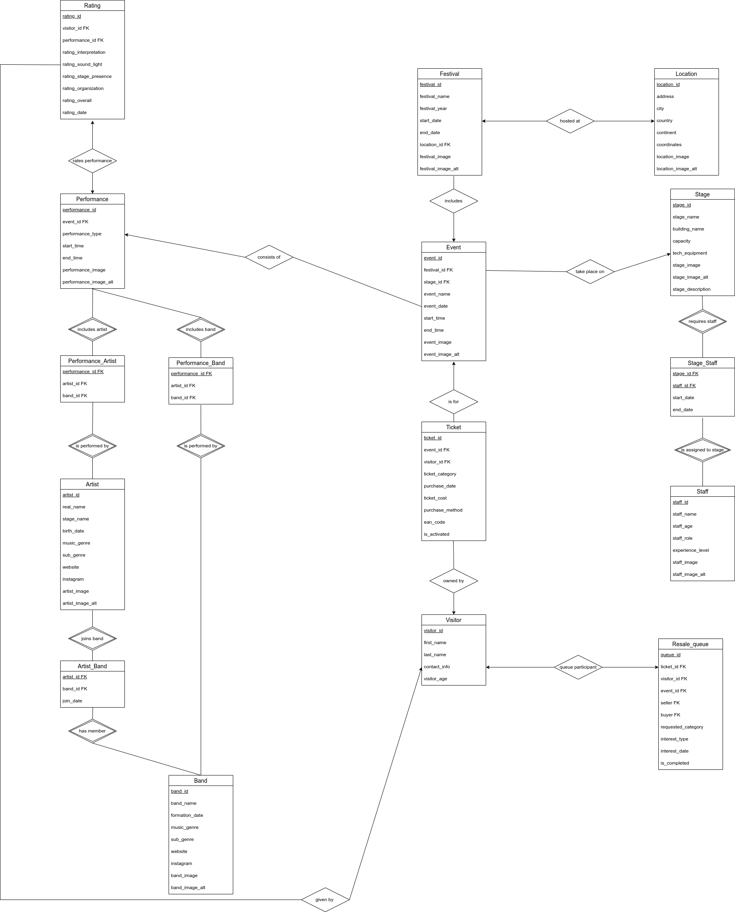
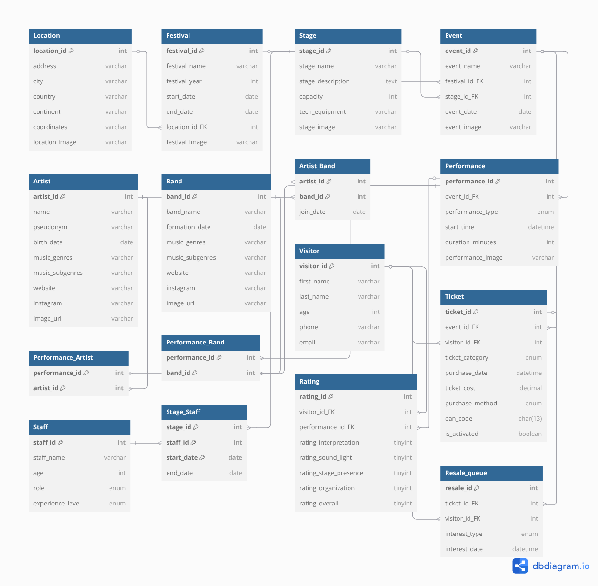

# Pulse Festival Database

A relational database for managing an international music festival: locations, festival editions, stages, events, performances, artists and bands, staff, visitors, tickets, performance ratings and a ticket resale queue. The project covers the full cycle, from E/R modeling to integrity enforcement, mock data generation and query optimization.

Individual project for **Databases 2024–25** at the School of Electrical & Computer Engineering, National Technical University of Athens (NTUA).


---

## Highlights

- **Schema:** 16 tables with 21 foreign keys (explicit `ON UPDATE` / `ON DELETE` policies), 21 `CHECK` constraints, unique constraints and composite keys.
- **Business rules as triggers:** 7 `BEFORE INSERT` triggers enforce rules that plain constraints cannot express (table below).
- **Reproducible mock data:** a Python generator ([`code/data.py`](code/data.py)) built on Faker uses a fixed seed. It plants seed cases for specific queries and fails with an `AssertionError` if any of them is missing.
- **15 analytical queries** using window functions, `WITH ROLLUP` and recursive CTEs. Every query has its result saved next to it.
- **Query optimization study:** `EXPLAIN` and optimizer-trace analysis with `FORCE INDEX` and nested-loop vs. hash join hints.
  - Q06 query cost: **142 → 3**, with a composite index.
  - Q04 query cost: **320 → 31**.
  - Bulk-load time: **18 s → 4.3 s**, by disabling FK checks and heavy triggers during `LOAD DATA`.
- **Full technical report** in LaTeX: [`docs/report.pdf`](docs/report.pdf), written in Greek.

---

## Data model

| E/R diagram | Relational schema |
|---|---|
|  |  |

### Business-rule triggers

| Trigger | Rule enforced |
|---|---|
| `trg_staff_quota` | Security staff ≥ 5 % and support staff ≥ 2 % of stage capacity |
| `trg_event_overlap` | No overlapping events on the same stage |
| `trg_performance_gap` | 5–30 min break between consecutive performances |
| `trg_artist_double_booking` | An artist cannot perform on two stages at the same time |
| `trg_artist_consecutive_years` | An artist can perform in at most 3 consecutive years |
| `trg_ticket_capacity` | Tickets sold ≤ stage capacity, VIP tickets ≤ 10 % |
| `trg_rating_allowed` | Only holders of an activated ticket can rate a performance |

### Design assumptions

- EAN-13 ticket codes are unique.
- Ticket price is fixed per day and category.
- Coordinates are stored as `POINT(lon lat)`.
- Staff quotas are rounded up (`CEIL`).
- The resale queue is served strictly FIFO by interest date.
- Future festival editions (2026–2027) are allowed.

---

## Queries

| # | Question answered |
|---|---|
| Q01 | Revenue per year, broken down by payment method (`WITH ROLLUP`) |
| Q02 | Artists of a given genre and whether they performed in a given year |
| Q03 | Artists with more than 2 warm-up appearances at the same festival |
| Q04 | Average interpretation and overall rating of an artist (plus 4 optimizer variants) |
| Q05 | Young artists (< 30) with the most festival appearances |
| Q06 | A visitor's average rating per performance attended (plus 4 optimizer variants) |
| Q07 | Festival with the lowest average experience level of its technical staff |
| Q08 | Support staff not assigned to any stage on a given date |
| Q09 | Visitors who attended the same number (> 3) of performances in 2025 |
| Q10 | Top-3 most frequent genre / sub-genre pairs across performances |
| Q11 | Artists with at least 5 fewer appearances than the most active artist |
| Q12 | Staff needed per festival day and staff category (recursive CTE) |
| Q13 | Artists who have performed on at least 3 different continents |
| Q14 | Genres with the same number (≥ 3) of appearances in two consecutive years |
| Q15 | Top-5 visitors who gave the highest total ratings to a single artist |

The SQL is in [`sql/`](sql). Each query `QNN.sql` has its output in `QNN_out.txt`. Variants `a`–`d` of Q04 and Q06 contain the optimization experiments.

---

## Running locally

Requirements: MySQL 8 and Python 3 with `faker` and `pandas`.

```bash
# 1. Generate the mock data (CSV files are written to ./csv_data)
pip install faker pandas
python code/data.py

# 2. Create the schema, indexes and triggers
mysql -u root -p < sql/install.sql

# 3. Load the data (LOAD DATA INFILE reads from MySQL's secure_file_priv folder)
sudo cp csv_data/*.csv /var/lib/mysql-files/
mysql -u root -p music_festival < sql/load.sql

# 4. Run any query
mysql -u root -p music_festival < sql/Q04.sql
```

Ready-made CSVs are also in [`code/`](code).

---

## Repository layout

```
sql/        install.sql (DDL, indexes, triggers), load.sql, Q01–Q15 and their outputs
code/       Mock data generator (data.py) and the generated CSVs
docs/       Report (LaTeX source + PDF), E/R and relational diagrams
diagrams/   E/R and relational diagrams (PDF)
```

---

*Author: Dimitrios Liakis*
